# Manual de usuario de Mini-Maltego académico

Este manual explica cómo instalar, iniciar y usar Mini-Maltego académico en
Windows, con VS Code y PowerShell. Está pensado para una persona sin experiencia
previa en el proyecto.

Las capturas de este documento se tomaron de la interfaz real con una base de
demostración ficticia creada por `scripts/preparar_demo.py`. Los dominios y las
direcciones IP son de documentación (`example.com`, `192.0.2.x`, `2001:db8::`).
La consulta DNS de la sección 19 y siguientes se simuló en el navegador para
las capturas; en ese caso la fuente aparece como `simulacion-demo-sin-red`.
Para el recorrido de clase, consultá [demo-presentacion.md](demo-presentacion.md).

## 1. Introducción y objetivos

Mini-Maltego académico permite registrar **entidades** (personas, organizaciones,
correos, usuarios, dominios, sitios web e IP) y **relaciones** entre ellas. Esas
relaciones forman un **grafo dirigido**: cada flecha tiene un origen y un destino.

Al terminar este manual vas a poder:

- iniciar la aplicación y abrirla en el navegador;
- crear, editar y relacionar entidades;
- visualizar el grafo y cambiar su distribución;
- ejecutar BFS, DFS y el camino más corto, y leer sus resultados;
- consultar registros DNS públicos como vista previa y, si lo decidís, incorporar
  registros A y AAAA al grafo;
- entender qué se guardó, qué se reutilizó y de dónde vino cada dato;
- ejecutar las pruebas automatizadas.

## 2. Alcance académico

El proyecto es un ejercicio de Algoritmos y Estructuras de Datos 3. Sirve para
estudiar grafos, recorridos y persistencia. **No es una herramienta OSINT
profesional** y no recopila información externa automáticamente: las consultas
DNS ocurren solo cuando las pedís, y no guardan nada hasta que confirmás una
incorporación.

## 3. Requisitos de software

| Software | Versión usada en la verificación | Notas |
| --- | --- | --- |
| Windows 10 u 11 | Windows con PowerShell | Los comandos de este manual son de PowerShell. |
| Python | 3.13.3 | El repositorio no declara una versión mínima. El lanzador `py` debe estar disponible. |
| VS Code | Cualquier versión reciente | Se usa su terminal integrada. No hace falta ninguna extensión. |
| Navegador | Probado con un navegador basado en Chromium | Debe tener JavaScript habilitado. |
| Git | Opcional | Solo si vas a obtener el proyecto con Git. |

No hace falta instalar Node.js ni compilar nada: la interfaz son archivos HTML,
CSS y JavaScript que el propio servidor entrega.

## 4. Instalación en Windows con VS Code

1. Instalá Python 3.13 desde el sitio oficial o desde la Microsoft Store. En el
   instalador oficial, dejá marcada la opción que agrega el lanzador `py`.
2. Instalá [VS Code](https://code.visualstudio.com/).
3. Abrí la carpeta del proyecto: en VS Code, **Archivo > Abrir carpeta** y
   seleccioná la carpeta que contiene `README.md`, `AGENTS.md` y `requirements.txt`.
4. Abrí la terminal integrada: **Terminal > Nueva terminal**. Debe mostrar
   PowerShell. Todos los comandos siguientes se ejecutan desde la raíz del proyecto.
5. Verificá Python:

   ```powershell
   py -3 --version
   ```

   Debe mostrar `Python 3.13` o una versión 3.x reciente.

## 5. Creación y activación del entorno virtual

Si la carpeta `.venv` no existe, creala:

```powershell
py -3 -m venv .venv
```

**Activar el entorno es opcional.** Los comandos de este manual usan la ruta
completa `.\.venv\Scripts\python.exe`, que funciona sin activación. Si preferís
activarlo, ejecutá:

```powershell
.\.venv\Scripts\Activate.ps1
```

En muchos equipos de Windows, PowerShell muestra un error porque la política de
ejecución impide ejecutar scripts (*"la ejecución de scripts está deshabilitada
en este sistema"*). En ese caso, en la **misma** ventana de terminal, ejecutá:

```powershell
Set-ExecutionPolicy -Scope Process -ExecutionPolicy RemoteSigned
.\.venv\Scripts\Activate.ps1
```

Este ajuste solo dura mientras la ventana está abierta y no cambia la
configuración del equipo. Verificado en el entorno del repositorio.

## 6. Instalación de dependencias

Con el entorno creado, instalá las dependencias de ejecución:

```powershell
.\.venv\Scripts\python.exe -m pip install -r requirements.txt
```

Si además vas a ejecutar las pruebas y los controles de calidad, instalá las de
desarrollo, que incluyen las anteriores:

```powershell
.\.venv\Scripts\python.exe -m pip install -r requirements-dev.txt
```

Para comprobar que no hay dependencias rotas:

```powershell
.\.venv\Scripts\python.exe -m pip check
```

Debe responder `No broken requirements found.`

## 7. Comandos exactos para iniciar el sistema

Desde la raíz del proyecto:

```powershell
.\.venv\Scripts\python.exe -m uvicorn app.api.main:app --host 127.0.0.1 --port 8000
```

La terminal muestra que el servidor quedó escuchando en `http://127.0.0.1:8000`.
**Dejá esa terminal abierta** mientras uses la aplicación. Para detenerla, usá
`Ctrl+C`.

Por defecto, los datos se guardan en `data/mmg.sqlite3`, relativo a la carpeta
desde la que iniciaste el servidor. **Para practicar sin tocar tus datos**,
definí otra base antes de iniciar, como se muestra en la sección 25 y en
[demo-presentacion.md](demo-presentacion.md). La variable dura solo en esa
ventana de PowerShell.

## 8. Cómo abrir la interfaz en el navegador

Abrí en el navegador:

- Interfaz: <http://127.0.0.1:8000/>
- Estado del servidor: <http://127.0.0.1:8000/health>. Debe mostrar `{"status":"ok"}`.
- Documentación interactiva de la API: <http://127.0.0.1:8000/docs>

**No hace falta Live Server ni otro servidor.** FastAPI entrega la interfaz desde
el mismo puerto que la API. Las llamadas de la página usan rutas relativas
(`/api/v1/...`), por lo que la interfaz solo funciona cuando se abre desde ese
servidor. Si abrís `index.html` con otra herramienta, o con un servidor en otro
puerto, las acciones no van a encontrar la API.

## 9. Descripción de las secciones principales

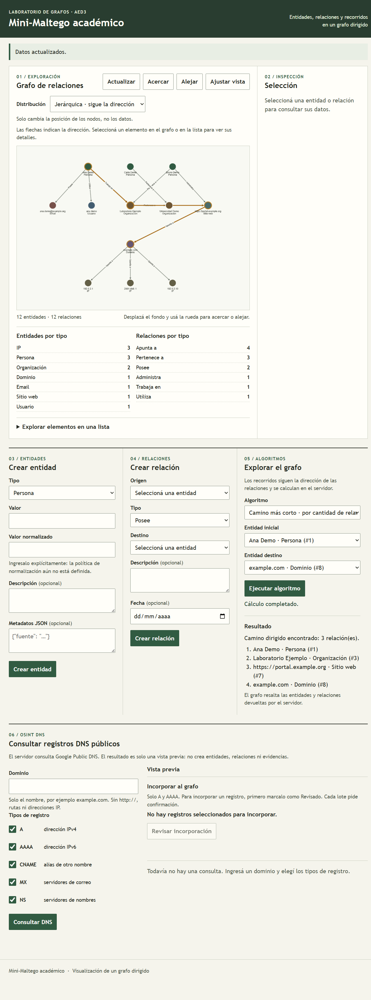

*Figura 1. Pantalla principal con datos de la demostración.*

La página tiene seis bloques numerados:

| Bloque | Qué contiene |
| --- | --- |
| Barra de estado (arriba) | Mensajes generales, por ejemplo "Datos actualizados." |
| 01 / Exploración | Grafo, botones **Actualizar**, **Acercar**, **Alejar**, **Ajustar vista**, el selector **Distribución**, los contadores por tipo y la lista desplegable de elementos. |
| 02 / Inspección | Detalle del elemento seleccionado, con el botón para editarlo. |
| 03 / Entidades | Formulario **Crear entidad**. |
| 04 / Relaciones | Formulario **Crear relación**. |
| 05 / Algoritmos | Selector de algoritmo, entidad inicial y resultado. |
| 06 / OSINT DNS | Consulta de registros DNS, vista previa e incorporación al grafo. |

Antes de cada escritura en la base, la aplicación pide confirmación con el
mensaje **"Esta acción guardará datos en el proyecto. ¿Continuar?"**. Aceptá solo
si querés guardar.

## 10. Creación y edición de entidades

### Crear una entidad

1. En **03 / Entidades**, elegí el **Tipo**: Persona, Organización, Email,
   Usuario, Dominio, Sitio web o IP.
2. Escribí el **Valor**, por ejemplo `Carla Demo`.
3. Escribí el **Valor normalizado**. Es obligatorio y se ingresa a mano porque
   todavía no hay una política de normalización automática. Para la demostración
   usá minúsculas sin espacios, por ejemplo `carla-demo`.
4. Opcionalmente escribí una **Descripción** y **Metadatos JSON**. Los metadatos
   deben ser un objeto JSON válido, por ejemplo `{"fuente": "ficha de clase"}`.
5. Hacé clic en **Crear entidad** y aceptá la confirmación.

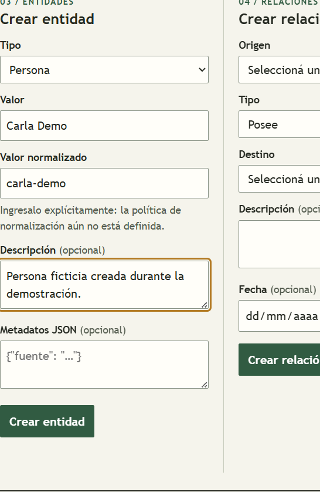

*Figura 2. Formulario de entidad completo, antes de guardar.*

Si todo salió bien, el mensaje debajo del botón dice **"Entidad creada."** y el
contador del grafo aumenta.

Dentro de un mismo **tipo**, el valor normalizado debe ser único. Si intentás
crear una entidad que ya existe, el servidor responde con un conflicto y no
guarda nada:

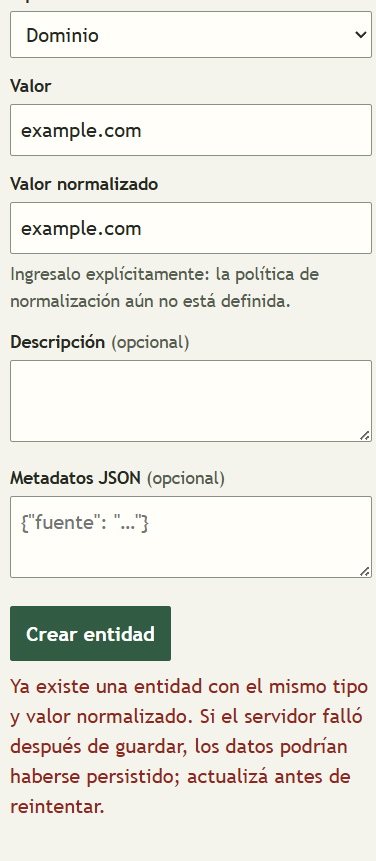

*Figura 3. El CRUD rechaza un dominio duplicado (409) y no crea una segunda entidad.*

### Editar una entidad

1. Seleccioná la entidad en el grafo o en la lista (sección 14).
2. En **02 / Inspección**, hacé clic en **Editar entidad**.
3. Cambiá los campos: Tipo, Valor, Valor normalizado, Descripción o Metadatos.
4. Hacé clic en **Guardar cambios** y aceptá la confirmación. Para descartar,
   usá **Cancelar**.

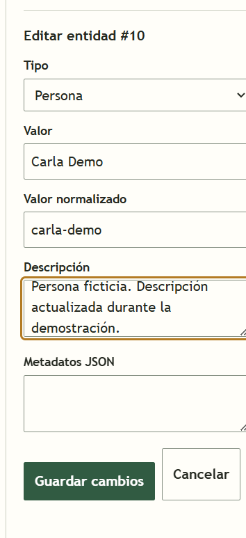

*Figura 4. Edición en línea dentro del inspector.*

Tras guardar, aparece **"Entidad #N actualizada."** y el elemento sigue
seleccionado. El identificador no cambia y las relaciones existentes se conservan.

## 11. Creación y gestión de relaciones

### Crear una relación

1. En **04 / Relaciones**, elegí el **Origen** y el **Destino** en las listas.
2. Elegí el **Tipo**: Posee, Utiliza, Trabaja en, Administra, Pertenece a o
   Apunta a.
3. Opcionalmente escribí una **Descripción** y una **Fecha**.
4. Hacé clic en **Crear relación** y aceptá la confirmación.

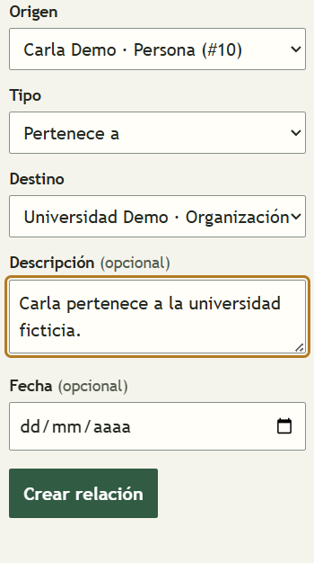

*Figura 5. Relación `Carla Demo → Pertenece a → Universidad Demo`, antes de guardar.*

El mensaje **"Relación creada."** confirma la operación. La relación es dirigida:
`A → B` no es lo mismo que `B → A`. No se permiten dos relaciones con el mismo
origen, destino y tipo; sí se permiten bucles (origen igual a destino) y
relaciones entre los mismos extremos con tipos distintos.

### Editar una relación

Seleccioná la relación, hacé clic en **Editar relación** dentro del inspector y
modificá origen, tipo, destino, descripción o fecha (formato `AAAA-MM-DD`). Las
evidencias existentes se conservan.

### Inspeccionar una relación y sus evidencias

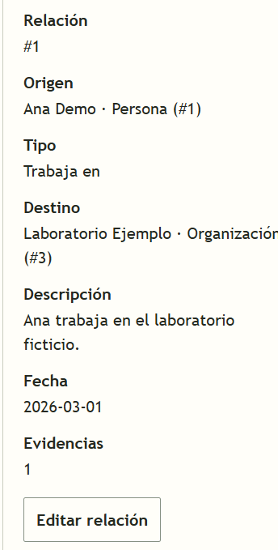

*Figura 6. El inspector muestra el número de evidencias de la relación.*

El inspector indica cuántas evidencias tiene la relación. Su contenido se consulta
por la API (sección 24). La interfaz **no elimina** entidades ni relaciones, y
tampoco crea evidencias: esas operaciones están en la API (ver sección 27).

## 12. Visualización del grafo dirigido

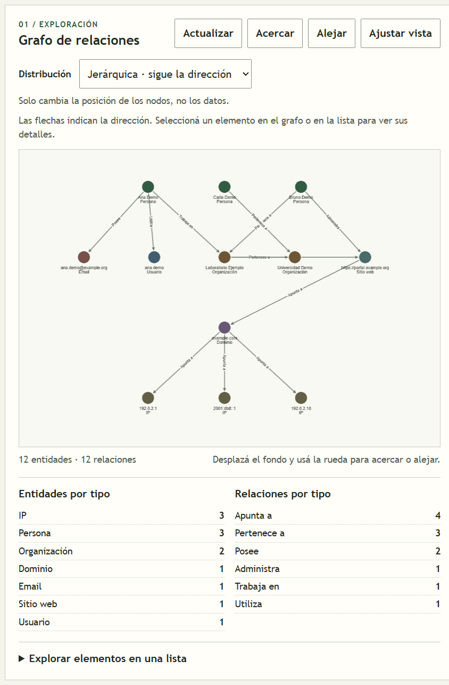

*Figura 7. Grafo con entidades conectadas. Las flechas indican la dirección de cada relación.*

- Cada **nodo** es una entidad y cada **flecha** es una relación. El texto junto
  a la flecha es el tipo de relación.
- Debajo del grafo, **Entidades por tipo** y **Relaciones por tipo** muestran
  cuántos elementos hay de cada tipo.
- Con la rueda del mouse o los botones **Acercar** y **Alejar** cambiás el zoom.
  **Ajustar vista** encaja todo el grafo en el recuadro.
- **Explorar elementos en una lista** despliega las listas de entidades y
  relaciones, con el mismo contenido que el grafo.

## 13. Uso de layouts

El selector **Distribución** cambia **solo la posición** de los nodos. No
modifica datos ni relaciones. La última opción elegida se recuerda en el
navegador.

| Opción | Cuándo conviene | Captura |
| --- | --- | --- |
| Fuerzas · agrupa lo conectado | Ver grupos de elementos relacionados. | 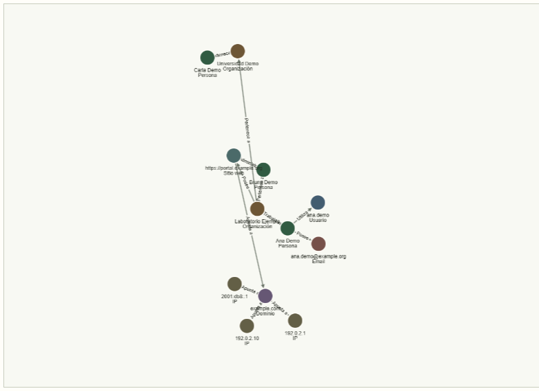 |
| Jerárquica · sigue la dirección | Leer el sentido de las flechas. Es la más clara para estudiar BFS y DFS. | 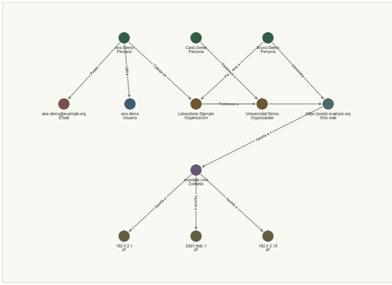 |
| Concéntrica · centro por grado | Ver qué nodos tienen más conexiones en el centro. | 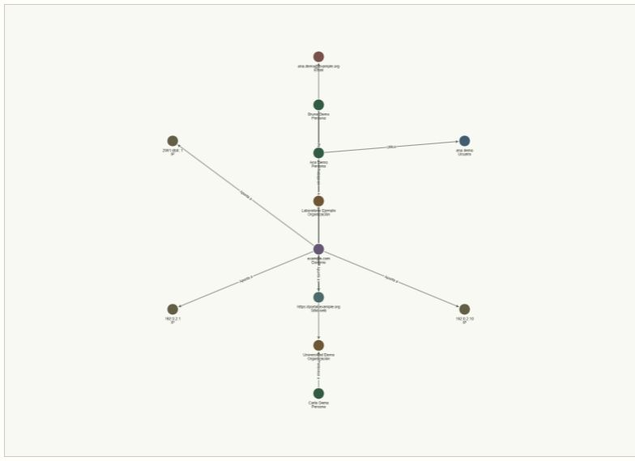 |
| Círculo · orden uniforme | Comparar todos los nodos sin jerarquía. | 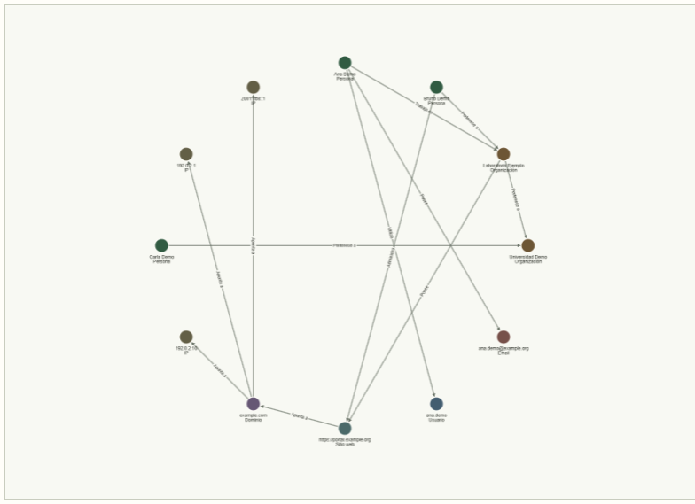 |
| Cuadrícula · lectura ordenada | Leer la lista de nodos en filas. | 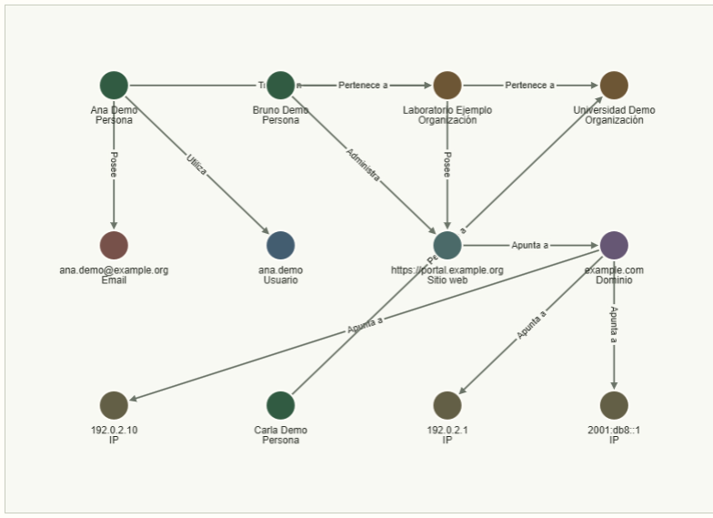 |

Con grafos grandes, las etiquetas pueden verse pequeñas: acercá la vista con
**Acercar** o usá la lista desplegable.

## 14. Búsqueda y exploración de entidades

**Importante:** la interfaz **no tiene un buscador por texto**. La exploración se
hace de tres formas:

1. **Clic en el grafo.** Al seleccionar un nodo o una flecha, el inspector muestra
   sus datos.
2. **Lista desplegable.** En **Explorar elementos en una lista**, hacé clic en
   una entidad o una relación para seleccionarla.
3. **Listas de los formularios y de los algoritmos.** Cada entidad aparece como
   `Nombre · Tipo (#id)`. El número `#id` es el identificador que devuelve la base,
   y es útil para distinguir dos elementos con el mismo nombre.

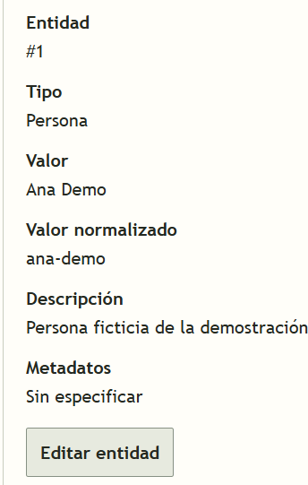

*Figura 8. Entidad seleccionada desde la lista: tipo, valor, valor normalizado, descripción y metadatos.*

Para buscar por texto en la lista de la página, podés usar la función de búsqueda
del navegador (`Ctrl+F`). Esa búsqueda no es parte de la aplicación.

## 15. BFS

BFS (*breadth-first search*, recorrido en anchura) visita primero los vecinos
directos de la entidad inicial, después los que están a dos relaciones, y así
sucesivamente. Solo recorre lo que se puede alcanzar **siguiendo la dirección** de
las relaciones.

Para ejecutarlo:

1. En **05 / Algoritmos**, elegí **BFS · recorrido por niveles**.
2. Elegí la **Entidad inicial**, por ejemplo `Ana Demo · Persona (#1)`.
3. Hacé clic en **Ejecutar algoritmo**.

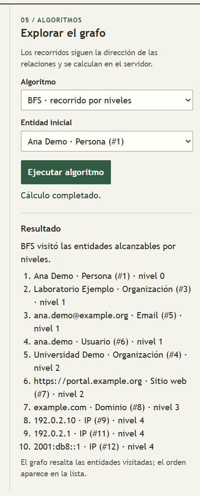

*Figura 9. Resultado de BFS: cada entidad aparece con su nivel.*

## 16. DFS

DFS (*depth-first search*, recorrido en profundidad) avanza por un camino todo lo
posible antes de volver atrás. El orden depende del orden en que se guardaron las
relaciones.

Para ejecutarlo, elegí **DFS · recorrido en profundidad**, la entidad inicial y
**Ejecutar algoritmo**.

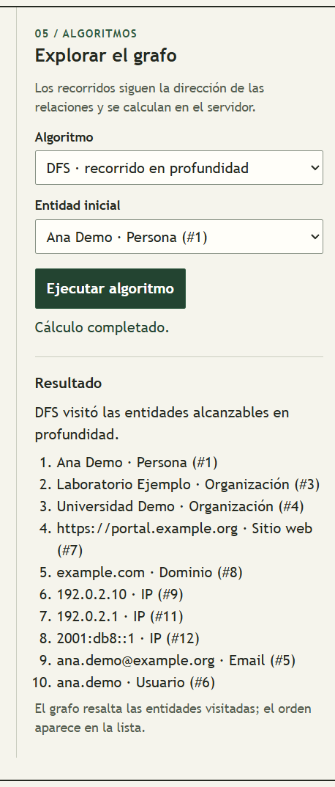

*Figura 10. Resultado de DFS: solo se muestra el orden de visita.*

## 17. Camino más corto

El camino más corto busca la secuencia de relaciones con la **menor cantidad**
de aristas que lleva del origen al destino siguiendo la dirección. No considera
pesos ni costos.

Para ejecutarlo:

1. Elegí **Camino más corto · por cantidad de relaciones**.
2. Elegí la **Entidad inicial** (origen) y la **Entidad destino**.
3. Hacé clic en **Ejecutar algoritmo**.

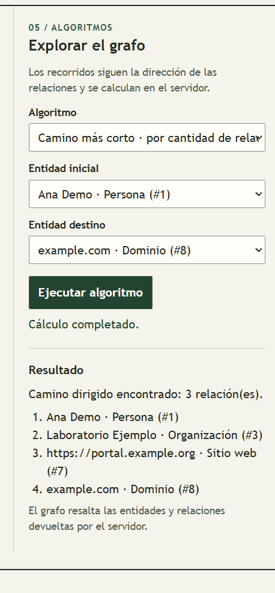

*Figura 11. Camino de Ana Demo a example.com: 3 relaciones.*

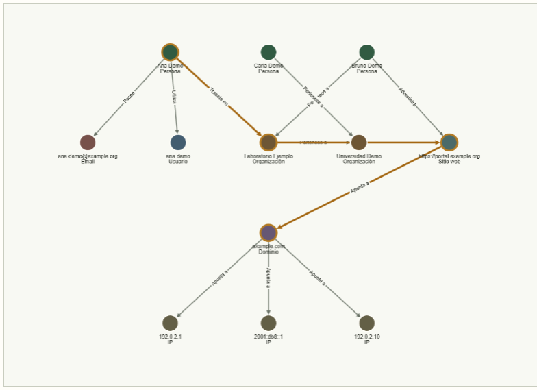

*Figura 12. El grafo resalta las entidades y relaciones del camino.*

## 18. Interpretación de los resultados

Con la base de demostración, los resultados son estos:

- **BFS desde Ana Demo:** Ana Demo (nivel 0); Laboratorio Ejemplo, el correo y el
  usuario (nivel 1); Universidad Demo y el portal (nivel 2); `example.com` (nivel 3);
  y las IP `192.0.2.10`, `192.0.2.1` y `2001:db8::1` (nivel 4). El nivel es la
  cantidad mínima de relaciones necesarias para llegar desde la entidad inicial.
  Las dos últimas IP aparecen porque se incorporaron en la sección 22.
- **DFS desde Ana Demo:** Ana Demo, Laboratorio Ejemplo, Universidad Demo, portal,
  `example.com`, `192.0.2.10`, `192.0.2.1`, `2001:db8::1`, correo, usuario. Se visita
  una rama completa antes de volver a la siguiente.
- **Camino de Ana Demo a `example.com`:** encontrado, con 3 relaciones:
  `Ana Demo → Trabaja en → Laboratorio Ejemplo → Posee → portal → Apunta a → example.com`.
- **Camino de `example.com` a Ana Demo:** no existe. El mensaje dice *"No existe un
  camino dirigido entre las entidades seleccionadas."* Las flechas tienen sentido:
  `example.com` no tiene relaciones salientes hacia Ana.

Recordá que la dirección importa: si un camino no aparece, probá invirtiendo el
origen y el destino, y revisá en qué sentido apuntan las flechas.

## 19. Consulta OSINT DNS

La sección **06 / OSINT DNS** consulta registros DNS públicos a través de Google
Public DNS. **La consulta no guarda nada**: el resultado es una vista previa.

1. En **Dominio**, escribí solo el nombre, por ejemplo `example.com`. No escribas
   `http://`, rutas ni direcciones IP.
2. Dejá marcados los tipos que quieras: **A** (IPv4), **AAAA** (IPv6), **CNAME**,
   **MX** (correo) y **NS** (servidores de nombres).
3. Hacé clic en **Consultar DNS**. Puede tardar algunos segundos.

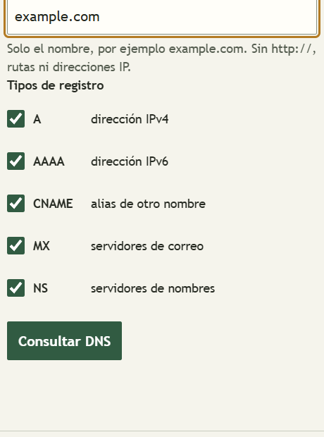

*Figura 13. Formulario de consulta DNS antes de enviarla.*

Una consulta sin red o con un proveedor que no responde no termina en un error
genérico: la vista previa muestra un estado por tipo, como **Error de red**,
**Error de timeout** o **Error HTTP**.

## 20. Revisión de registros

La vista previa muestra los resultados agrupados por tipo. Cada registro indica:

- el **valor** (IP, nombre de host o prioridad en MX);
- el **estado** (Encontrado o Sin registros);
- la **fuente** y la **fecha de consulta**;
- si parece **duplicado** de una entidad existente.

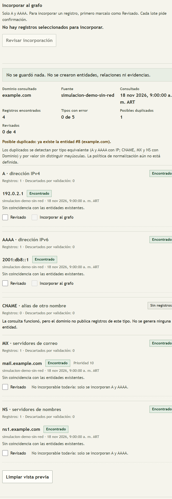

*Figura 14. Resultados por tipo. La fuente `simulacion-demo-sin-red` indica que la respuesta fue simulada para la demostración.*

Un registro marcado como **Posible duplicado** significa que existe una entidad
con el mismo valor. Es una heurística de la vista, no una decisión del servidor.
En este ejemplo, `example.com` ya existía como dominio (#8) y aparece señalado.

Para revisar un registro, marcá **Revisado**. Un registro sin revisar no puede
incorporarse.

## 21. Selección de registros A y AAAA

Solo los registros **A** y **AAAA** se pueden incorporar al grafo. CNAME, MX y NS
se muestran, pero sin control de incorporación todavía.

1. Marcá **Revisado** en el registro A y en el registro AAAA.
2. Marcá **Incorporar al grafo** en esos mismos registros. Ese control se habilita
   solo cuando el registro está revisado. Al desmarcar **Revisado**, se quita también
   la selección.
3. El contador muestra cuántos registros quedaron seleccionados.

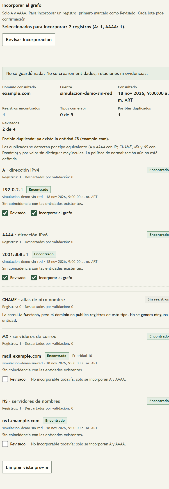

*Figura 15. Registros A (192.0.2.1) y AAAA (2001:db8::1) revisados y seleccionados.*

## 22. Confirmación de incorporación al grafo

Hacé clic en **Revisar incorporación**. Aparece un panel con:

- el dominio de origen;
- la lista de registros a incorporar;
- la aclaración de que se crearán o reutilizarán entidades, relaciones y evidencias;
- la procedencia declarada por el cliente.

Para guardar, hacé clic en **Confirmar incorporación**. Para cancelar, usá
**Cancelar**. Nada se envía hasta confirmar.

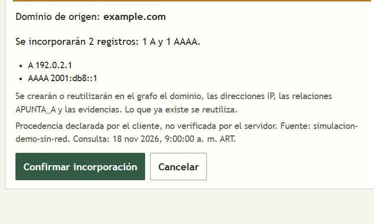

*Figura 16. Confirmación del lote antes de enviarlo.*

## 23. Diferencia entre elementos creados y reutilizados

Al terminar, el panel **Resultado de la incorporación** informa qué se creó y qué
se reutilizó, para el dominio, las entidades IP, las relaciones `APUNTA_A` y las
evidencias.

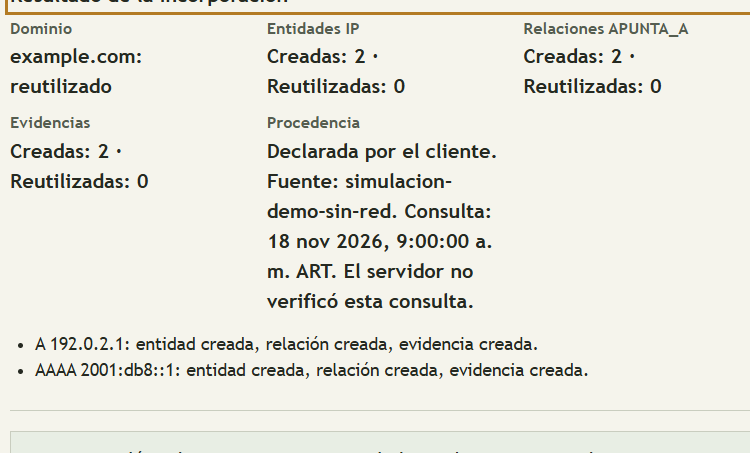

*Figura 17. El dominio `example.com` se reutilizó. Se crearon dos IP, dos relaciones y dos evidencias.*

El grafo se actualiza con los datos guardados:

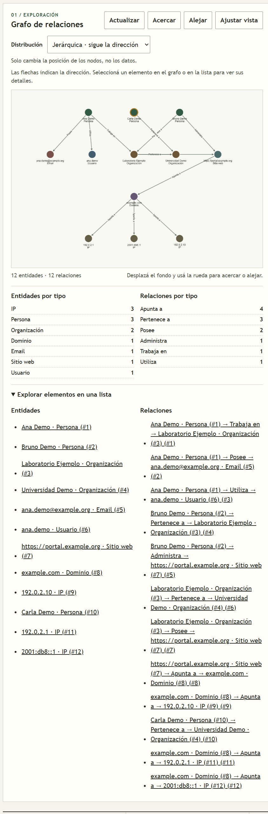

*Figura 18. Las IP nuevas aparecen conectadas a `example.com` con la relación `APUNTA_A`.*

Reglas que aplica la incorporación:

- **Dominio:** si ya existe una entidad equivalente, se reutiliza. Si hay dos
  entidades equivalentes en conflicto, la incorporación responde 409 y no guarda
  nada.
- **IP:** si la dirección ya existe como entidad IP, se reutiliza.
- **Relación `APUNTA_A`:** si ya existe con el mismo origen y destino, se reutiliza.
- **Evidencia:** si ya existe una con la misma fuente, fecha y descripción, se
  reutiliza. Así, repetir el mismo lote no duplica nada.

Esta repetición se comprobó en la API: al enviar otra vez el mismo lote, todos los
elementos respondieron `reutilizada` y el total de entidades no cambió.

## 24. Evidencias y procedencia

Una **evidencia** registra de dónde proviene un dato asociado a una relación. Las
evidencias de una relación se leen en la API:

```powershell
Invoke-RestMethod http://127.0.0.1:8000/api/v1/relaciones/1
```

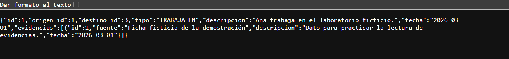

*Figura 19. La relación 1 incluye su evidencia: fuente, descripción y fecha.*

Para crear una evidencia, usá la documentación interactiva en
<http://127.0.0.1:8000/docs>, en `POST /api/v1/relaciones/{relation_id}/evidencias`,
con un cuerpo como este:

```json
{
  "fuente": "Ficha de clase",
  "descripcion": "Dato de práctica",
  "fecha": "2026-03-02"
}
```

**Procedencia de la incorporación DNS.** Las evidencias creadas por la
incorporación guardan la fuente con el prefijo `declarada por el cliente: `. Eso
significa que la fuente y la fecha las informó la página al enviar el lote. **El
servidor no volvió a consultar el DNS ni verificó esos datos.** El panel lo indica
con la frase *"Declarada por el cliente. [...] El servidor no verificó esta
consulta."*

## 25. Errores frecuentes y recuperación

| Situación | Qué significa | Qué hacer |
| --- | --- | --- |
| *"la ejecución de scripts está deshabilitada"* al activar el entorno | La política de PowerShell bloquea `Activate.ps1`. | Usá la ruta completa `.\.venv\Scripts\python.exe` o ejecutá el ajuste de la sección 5. |
| *"No se pudo conectar con el servidor. Comprobá que esté en ejecución."* | La página no encuentra la API. | Revisá que la terminal del servidor siga abierta y que la dirección sea `http://127.0.0.1:8000/`. |
| *"Ya existe una entidad con el mismo tipo y valor normalizado."* (409) | Ya hay una entidad igual. | Buscala en la lista y usala, o cambiá el valor normalizado. |
| *"Los metadatos deben ser JSON válido."* | El campo de metadatos no es JSON. | Corregí el texto, por ejemplo `{"fuente": "clase"}`. |
| *"Usá Actualizar grafo"* | Los datos se guardaron, pero el grafo no se pudo redibujar. | Hacé clic en **Actualizar**. **No vuelvas a confirmar la incorporación**. |
| *"La consulta tardó demasiado y se canceló."* | El proveedor no respondió a tiempo. | Esperá unos minutos y volvé a consultar. |
| *"El servidor no pudo conectarse con el proveedor DNS."* (Error de red) | Falta conexión a Internet o el proveedor no es alcanzable. | Revisá la conexión. La consulta DNS necesita red; la demostración puede hacerse sin ella mostrando las capturas. |
| Un registro aparece como *"Posible duplicado"* después de incorporarlo | La heurística compara con las entidades cargadas en la vista. | No es un error de datos. Confirmá en el grafo que la entidad sea la esperada. |

**Procedimiento general ante un error:**

1. Mirá el mensaje debajo del formulario o en la barra de estado.
2. Hacé clic en **Actualizar** para recargar los datos del servidor.
3. Si una escritura falló con un error de red o de respuesta, **consultá los datos
   antes de reintentar**: el servidor pudo haber guardado la operación.
4. Si el servidor se detuvo, iniciá de nuevo el comando de la sección 7.

**Base equivocada.** Si los datos que ves no son los esperados, revisá si la
variable `MMG_DATABASE_PATH` está definida en esa ventana. Para volver a la base
por defecto, cerrá la ventana de PowerShell o ejecutá
`Remove-Item Env:MMG_DATABASE_PATH`.

## 26. Ejecución de pruebas automatizadas

Con las dependencias de desarrollo instaladas, desde la raíz:

```powershell
.\.venv\Scripts\python.exe -m pytest -q
```

En la verificación del 18 de noviembre de 2026 el resultado fue
**368 pruebas aprobadas y 1 omitida** (tardó unos 22 segundos). La prueba omitida
es la de red contra Google DNS, que requiere
`MMG_RUN_NETWORK_TESTS=1` y no se ejecuta por defecto.

Las pruebas usan bases temporales y no tocan `data/mmg.sqlite3`. Para los controles
de calidad:

```powershell
.\.venv\Scripts\python.exe -m ruff check .
.\.venv\Scripts\python.exe -m bandit -q -c bandit.yaml -r app
```

## 27. Limitaciones conocidas

Estas limitaciones están documentadas y no se ocultan. Algunas afectan la demostración.

**Limitaciones de la interfaz y de la API**

- No hay buscador por texto. La exploración se hace con el grafo, la lista y los
  formularios (sección 14).
- La interfaz **no elimina** entidades ni relaciones. La API sí tiene `DELETE`.
- La interfaz no muestra el contenido de las evidencias ni permite crearlas. Se
  consultan y se crean por la API.
- Si una lista de elementos es muy grande, las etiquetas del grafo pueden no leerse.

**Limitaciones de datos y de DNS**

- **IDNA 2008 no está implementado completamente.** La validación de nombres
  internacionales sigue una política propia limitada (ver `docs/agents/DECISIONS.md`,
  D-20 y P-06). No se garantiza compatibilidad total con IDNA 2008.
- **Los CRUD manuales pueden aceptar representaciones equivalentes de un dominio.**
  Por ejemplo, un nombre en Unicode y su forma en punycode pueden coexistir como
  entidades distintas. La incorporación DNS sí detecta ese caso.
- **La incorporación DNS responde 409 ante entidades ambiguas, sin escrituras
  parciales.** Si hay más de una entidad equivalente, el lote no se guarda y hay que
  resolver el conflicto antes de reintentar.
- **La sincronización del grafo en memoria se garantiza para un solo proceso.** Con
  varios procesos o varias instancias, cada una tiene su copia y no se sincronizan.
  Ejecutá una sola instancia con una sola base.
- **La incorporación de CNAME, MX y NS todavía no está implementada.** Esos tipos
  solo se muestran en la vista previa.
- **Las evidencias de procedencia declaradas por el cliente no equivalen a una
  verificación independiente.** El servidor guarda lo que informó la página.

**Limitaciones del algoritmo DFS**

- DFS está implementado de forma recursiva. En cadenas de más de unos mil nodos
  puede superar el límite de recursión de Python. En la verificación, una cadena de
  900 nodos funcionó y una de 1200 produjo `RecursionError`. BFS no tiene esa
  limitación en las mismas cadenas.

**Limitaciones de entorno**

- No hay autenticación. Se recomienda usar la aplicación solo en tu equipo, con
  `127.0.0.1`.
- Las consultas DNS reales requieren conexión y dependen del proveedor en el momento
  de la consulta.

## 28. Glosario básico

- **Entidad:** elemento que se registra en el grafo: persona, organización, correo,
  usuario, dominio, sitio web o IP.
- **Relación:** conexión dirigida entre dos entidades, con un tipo.
- **Grafo dirigido:** conjunto de entidades (nodos) y relaciones (flechas con sentido).
- **Nodo:** representación visual de una entidad.
- **Arista:** representación de una relación (la flecha).
- **BFS:** recorrido por niveles desde una entidad inicial.
- **DFS:** recorrido en profundidad desde una entidad inicial.
- **Camino más corto:** secuencia de relaciones con la menor cantidad posible entre dos entidades.
- **Nivel:** cantidad mínima de relaciones desde la entidad inicial hasta una entidad.
- **Evidencia:** registro de la fuente de un dato asociado a una relación.
- **Procedencia:** indicación de quién informó la fuente y la fecha de un dato.
- **DNS:** sistema que traduce nombres de dominio en direcciones y otros datos.
- **Registro A / AAAA:** dirección IPv4 / IPv6 de un nombre de dominio.
- **Registro CNAME:** alias de un nombre por otro nombre.
- **Registro MX:** servidor de correo de un dominio, con prioridad.
- **Registro NS:** servidor de nombres autoritativo de un dominio.
- **IDNA:** convenciones para usar nombres de dominio con caracteres no ASCII.
- **Punycode / forma `xn--`:** representación ASCII de un nombre internacional.
- **Vista previa:** resultado de una consulta que no se guarda hasta confirmar.
- **Incorporar:** guardar en el grafo los registros A o AAAA revisados y seleccionados.
- **API:** conjunto de rutas que la página usa para leer y escribir datos.
- **SQLite:** archivo de base de datos donde se guardan los datos.
